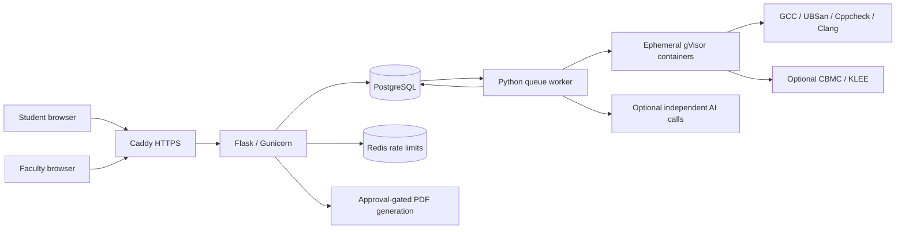

# Architecture

## Modules and lifecycle

`models.py` defines users, assignments, immutable submission configurations, reports and audit events. `web.py` enforces roles/ownership, uploads and approval. `worker.py` claims jobs with conditional UPDATEs and per-attempt tokens. `sandbox.py` sends source over stdin to ephemeral jobs. `agents.py` interprets independent evidence and optional specialty model calls. `pdf.py` renders complete approved reports in cloud memory.

States: `queued → evaluating → pending_review → approved`. Evaluation can fail; faculty retries failed/pending submissions. Evaluating leases older than 15 minutes become failed. Attempt tokens prevent stale-worker publication. Conditional approval prevents double publication; published results cannot be retried or modified through the UI. Audit and publication commit together.

## Trust boundaries

The web service has neither a Docker socket nor compiler. The trusted worker controls the grading daemon and must run on a dedicated grading host. Student code executes only inside non-root, read-only, networkless containers, with capabilities removed, no privilege escalation, process/memory/CPU limits, tmpfs scratch space and bounded output. Source is sent by stdin; host paths and credentials are never mounted into student containers. `/work` is noexec; only `/tmp` permits compiled execution. No host-execution fallback exists.

Docker socket access gives the trusted worker host authority. Use gVisor, patch toolchains and keep unrelated workloads off grading hosts. A single-host Compose deployment is supplied; separate web/database and grading hosts over a private network for stronger isolation. No container runtime guarantees immunity from every escape vulnerability.

## Access and confidentiality

Public registration always creates students; administrators provision faculty by CLI. Passwords use Werkzeug scrypt. CSRF protects state changes; cookies are Secure/HttpOnly/SameSite=Lax in deployment. Student detail/source/PDF routes enforce ownership; another student's ID returns 404. Draft reports never reach student templates. Approved reports are separate snapshots. Responses use no-store and restrictive content security headers. Faculty sees drafts on-screen; PDF download requires approval for everyone.

Audit events are append-only through application routes, not tamper-proof against database administrators. Logs, source, reports and backups contain student data and require access controls/retention policy. No result emails are sent; students refresh the dashboard.

## Scaling and persistence

Web replicas share PostgreSQL, Redis and session secrets. Multiple workers claim distinct jobs. `SANDBOX_CONCURRENCY` defaults to 1; raise it only with sufficient worker RAM/disk/CPU. PostgreSQL stores source, tests, rubrics, findings, feedback and approval snapshots. PDFs are generated on demand. Use managed encrypted disks/database, private connectivity and encrypted off-host backups. Introduce reviewed Alembic migrations before future schema changes; `init-db` initializes new deployments only.
